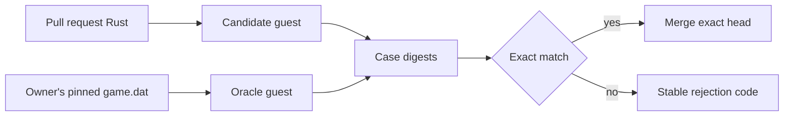

# sage-recomp

## Required game build

Contributors need their own copy of **The Lord of the Rings: The Battle for
Middle-earth II, patch 1.06**. The requested distribution link is:

```text
magnet:?xt=urn:btih:5c034e038ea47108d05ab0ba3550071e9d0c8f66&dn=the-lord-of-the-rings-the-battle-for-middle-earth-ii-v-1.06&tr=http%3A%2F%2Fbt1.archive.org%3A6969%2Fannounce&tr=http%3A%2F%2Fbt2.archive.org%3A6969%2Fannounce&ws=https%3A%2F%2Farchive.org%2Fdownload%2F&ws=http%3A%2F%2Fia600402.us.archive.org%2F9%2Fitems%2F&ws=http%3A%2F%2Fia800402.us.archive.org%2F9%2Fitems%2F
```

Use only a copy you are legally entitled to possess. This repository contains
no game executable, assets, or extracted resources. It identifies the required
binary only by immutable metadata:

```text
game.dat
size:   10969600 bytes
sha256: 1aa5dca6595820e508df31352275e533cce93dd3be7b0ed7528530413ce99c5d
```

Keep `game.dat` outside the checkout. It is mounted read-only for local
verification and is never uploaded or committed.

## Project

Collaborative binary recovery of BFME II's 32-bit SAGE executable into
dependency-light Rust suitable for the Bevy 0.19 engine port. The initial task
pool covers 21 measured, self-contained leaf functions in `sage-core`;
`sage-xfer` and the existing deterministic recovery code are included as context.


## Before claiming any work

Supported contributor hosts: Linux, or Windows through WSL2. Install:

- Git and Python 3.11 or newer
- Docker or Podman with a running daemon
- Recomp@Home at the framework revision pinned by this project:

```bash
python3 -m pip install "git+https://github.com/pickles976/DecompAtHome.git@76627fdcbe52232d665e263825171c9b9612fc35"
```

Fork and clone this repository, then run the readiness gate:

```bash
recomp task doctor --project . --target /path/to/game.dat
```

Do not claim an Issue unless the last line is exactly `GREENLIGHT`. The doctor
checks the target identity, container runtime, digest-pinned toolchain, Git
checkout, authentication, and platform prerequisites. If it reports a target
error, obtain the exact patch 1.06 `game.dat` described above and run it again.

## Contributor loop

```bash
recomp task next https://github.com/pickles976/sage-recomp
recomp task start https://github.com/pickles976/sage-recomp/issues/<n> --target /path/to/game.dat
recomp task run
# Implement only the task's declared recovery/crates/sage-core/src/recomp_tasks/port_NNNN.rs
recomp task verify
recomp task submit
```

`start` posts `/claim` and waits for a trusted lease from the coordinator App.
A lease lasts two hours; `recomp task heartbeat` renews it. Read
[`CONTRIBUTING.md`](CONTRIBUTING.md) and [`AGENTS.md`](AGENTS.md) before
editing.

## Verification model

Local verification compares the submitted Rust with the original x86 function
under Unicorn. The trusted coordinator repeats that comparison in two separate,
networkless Firecracker guests:



The candidate guest never receives `game.dat`; the oracle guest never receives
the contributor's source. Published results contain stable reason codes and
counts, not target bytes, host paths, or raw logs.

## Maintainer-owned files

Contributor pull requests may change only the output module declared by their
Issue. `.github/`, `plugins/`, `toolchain/`, `recomp.toml`,
`recomp.lock.toml`, `recomp-launcher`, `docs/progress.*`, and `AGENTS.md` are
policy-owned and rejected by preflight when modified.
