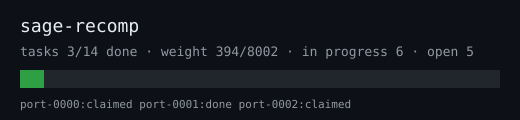
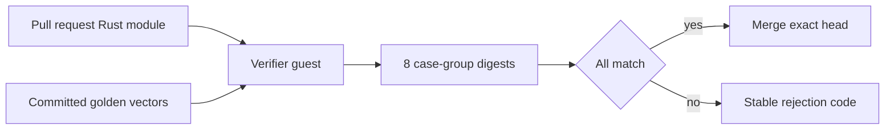

# sage-recomp

## Project

Crowdsourced **C++ → Rust port of `openbfme_core`**: the Godot-free SAGE engine
core of [Open-BFME/openbfme-godot](https://github.com/Open-BFME/openbfme-godot)
(411,476 lines, builds headless as `libopenbfme_core.a`).

One Issue is one upstream C++ module, one safe deterministic Rust module under
`recovery/crates/sage-core/src/port/`, and one pull request. Every port is
checked against **golden vectors** minted once by the project owner from the C++
reference build and committed under `goldens/`.

No copy of the game, no emulator, and no C++ toolchain are needed to
contribute. The upstream repository is GPL-3.0, so this port is GPL-3.0 as well.



## Before claiming any work

Supported contributor hosts: Linux, or Windows through WSL2. Install:

- Git and Python 3.11 or newer
- Docker or Podman with a running daemon
- Recomp@Home at the framework revision pinned by this project:

```bash
python3 -m pip install "git+https://github.com/pickles976/DecompAtHome.git@76627fdcbe52232d665e263825171c9b9612fc35"
```

Fork and clone this repository. `./scripts/contributor.sh setup` installs all of
the above on Ubuntu or Debian and finishes with the readiness gate:

```bash
recomp task doctor --project .
```

Do not claim an Issue unless the last line is exactly `GREENLIGHT`. The doctor
checks the container runtime, the digest-pinned toolchain, the Git checkout,
authentication, and platform prerequisites. This project declares no target
binary, so `--target` is never passed.

## Contributor loop

```bash
recomp task next https://github.com/pickles976/sage-recomp
recomp task start https://github.com/pickles976/sage-recomp/issues/<n>
recomp task run
# Implement only the task's declared recovery/crates/sage-core/src/port/<module>.rs
recomp task verify
recomp task submit
```

`./scripts/contributor.sh next|start|work|verify|submit` wraps the same
commands. `start` posts `/claim` and waits for a trusted lease from the
coordinator App. A lease lasts two hours; `recomp task heartbeat` renews it.
Read [`CONTRIBUTING.md`](CONTRIBUTING.md) and [`AGENTS.md`](AGENTS.md) before
editing.

## How you can help: give your AI agent this prompt

Fork and clone the repository, install the prerequisites with
`./scripts/contributor.sh setup`, then hand your coding agent exactly this:

> Read `PROMPT.md`, `AGENTS.md` and `CONTRIBUTING.md` in this repository and
> follow them. Loop: run `recomp task next https://github.com/pickles976/sage-recomp`,
> pick an open Issue, `recomp task start <issue-url>`, `recomp task run`, then
> port the upstream C++ module the Issue names into the single declared
> `recovery/crates/sage-core/src/port/<module>.rs`, implementing every `pub`
> signature the task record lists. Read the upstream sources at the pinned
> commit named in the Issue; translate their behaviour, never guess. The file
> must compile on its own: `core` and `std` only, no other crate modules, no
> external crates, no `unsafe`, no I/O, no clock, no randomness, no global
> mutable state. Run `recomp task verify` until all eight case-group digests
> match the golden vectors, then `recomp task submit`. Never edit `goldens/`,
> `reference/`, `tools/`, `scripts/`, `plugins/`, `toolchain/` or any file
> outside the declared output; never hard-code expected outputs or special-case
> the example rows in the golden file. One Issue, one module, one pull request
> with one `Closes #<issue>`. If upstream behaviour is ambiguous, say so in the
> pull request instead of guessing. When you stop, report tasks
> claimed/merged/rejected, the policy version, your real model name and minutes
> per task.

All such AI-generated pull requests are welcome; only the coordinator's
isolated verification and an exact-head merge count as progress.

## The port contract

The Issue's task record declares the upstream module, the Rust module name, and
the exact `pub` signatures to implement. The module must compile standalone:
`core` and `std` only, no external crates, no `use crate::…`, no `unsafe`, no
I/O, no clock, no randomness, no global mutable state, identical results on
every run and platform.

## Where the two lanes run

A contributor needs no KVM, no root, and no second machine: `recomp task
doctor`, `run`, `verify` and `submit` only use Git, a container runtime, and
the pinned toolchain image, so a contributor can develop, self-verify and push
from any Docker host, including Windows through WSL2. Publication
(`recomp github sync-tasks`) needs only network access as the App.

The coordinator is different: its verdict is authoritative, so it must run on a
KVM-capable Linux host. It executes *your* Rust, which is untrusted input,
inside a disposable networkless microVM; a container would share the host
kernel and expose host paths and running processes to it. That isolation is the
only reason a stranger's module can ever be merged without a human reading it.

### Keep the coordinator running with tmux

The coordinator is a foreground polling loop, not a system service. Run it in a
named tmux session so the owner can detach without stopping verification:

```bash
tmux new -s sage-coordinator
cd /path/to/sage-recomp
./scripts/coordinator.sh serve
```

Enter sudo once when `serve` starts; the launcher then drops back to the owner
account with only the capabilities needed by Firecracker's jailer. Detach with
`Ctrl-b d`, reattach with `tmux attach -t sage-coordinator`, and stop it with
`Ctrl-c` inside that session. Use separate named sessions for unrelated owner
work; list them with `tmux ls`.

### If a verified pull request is left unmerged

The loop verifies and merges the exact head inside one pass. GitHub can still
report the `recomp verification` check run as unfinished when the merge re-reads
it, in which case the merge is refused and the pull request stays open while the
task's lease is already `done`. `health.json` in
`~/.local/state/recomp/coordinators/<owner>__<repo>/` shows
`verified_unmerged: 1`, and the check run on the head says
`verification passed`.

Recover by squashing exactly that head:

```bash
curl -fsS -X PUT -H "Authorization: Bearer $GITHUB_TOKEN" \
  -H "Accept: application/vnd.github+json" \
  -d '{"sha":"<head-sha-the-check-run-is-green-on>","merge_method":"squash"}' \
  "https://api.github.com/repos/pickles976/sage-recomp/pulls/<number>/merge"
```

Never merge a head whose check run is not green, and never re-verify by hand:
the goldens and the case regeneration live only in the coordinator's guest.


## Verification model

`recomp task verify` generates 256 cases per declared function from the task's
`case_seed`, compiles your module alone, runs it, and compares the resulting
case-group digests with `goldens/<task-id>.json`. The trusted coordinator
repeats exactly that comparison in a disposable, networkless Firecracker guest:



A golden file carries 8 digests over 256 cases plus 8 visible example rows, so
hard-coding answers is not possible, and `goldens/` is always taken from the
trusted base rather than from the pull request. Published results contain stable
reason codes and counts, not host paths or raw logs.

## Maintainer-owned files

Contributor pull requests may change only the output module declared by their
Issue. `.github/`, `plugins/`, `toolchain/`, `goldens/`, `reference/`, `tools/`,
`scripts/`, `recomp.toml`, `recomp.lock.toml`, `recomp-launcher`,
`docs/progress.*`, and `AGENTS.md` are policy-owned and rejected by preflight
when modified.

## Repository rules

- `.cache/` holds the upstream checkout, the C++ reference build, and other
  heavy artefacts. It is reused between sessions and is never committed.
- No committed file may exceed 256 KB. No binaries, wheels, assets, build
  output, or Git LFS objects belong in this tree.
- Owner-only golden minting lives in `tools/mint_goldens.py` and
  `./scripts/coordinator.sh`; contributors never run the C++ build.
